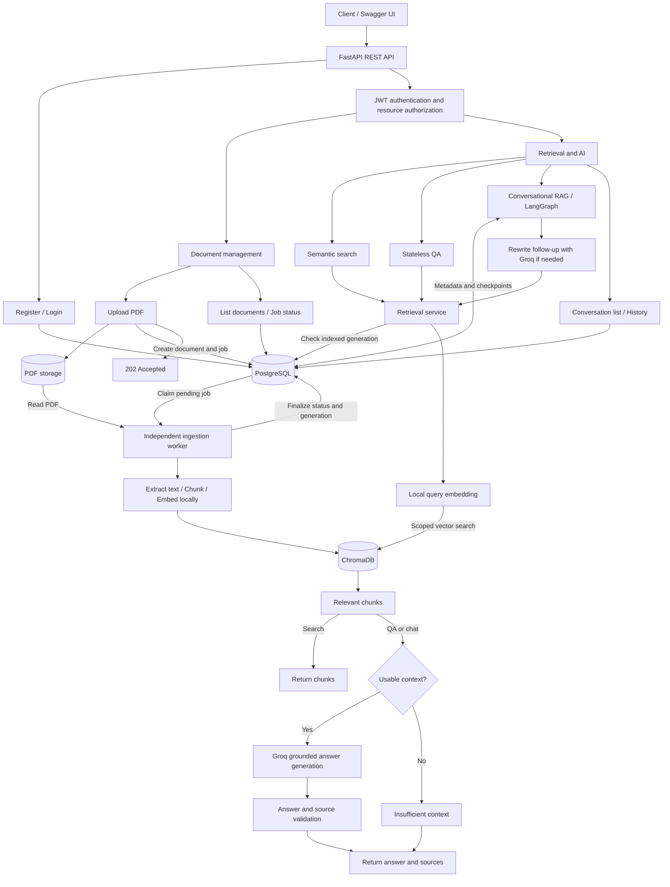

# RAGForge

**A multi-user, document-grounded AI knowledge API with asynchronous PDF ingestion and persistent conversations.**

[](https://github.com/mehmood22/ragforge/actions/workflows/ci.yml)


RAGForge turns text-based PDFs into searchable knowledge and lets authenticated users ask questions with page-level source references. It combines conventional backend engineering with retrieval-augmented generation (RAG), rather than treating an LLM as a standalone chatbot.

**Status:** v0.1.0, locally runnable portfolio project. Cloud hosting and continuous deployment are planned; continuous integration is configured.

## What it demonstrates

- Versioned REST API, Pydantic validation, service/repository separation and dependency injection.
- JWT authentication, Argon2 password hashing, document and conversation ownership checks.
- Asynchronous PDF ingestion with database-backed jobs, leases, bounded retries and generation-aware indexing.
- Local sentence-transformer embeddings, Chroma vector search and Groq-powered structured answers.
- LangGraph follow-up question rewriting and PostgreSQL-backed conversation checkpoints.
- Evidence-based answers, source citations and explicit insufficient-context responses.
- Docker Compose, Alembic migrations, structured logging, health checks, automated tests and LangSmith evaluation scripts.

## Architecture

See [architecture and design decisions](docs/ARCHITECTURE.md) for the separate upload, metadata, retrieval, stateless QA and conversational workflows.



The diagram shows logical dependencies, not one sequential request. For conversational requests, LangGraph persists state through PostgreSQL checkpoints before returning the result. See the detailed execution diagrams in the [architecture guide](docs/ARCHITECTURE.md).

PostgreSQL stores users, document metadata, jobs, conversation metadata and checkpoints. Chroma stores indexed chunks and vectors. The worker processes uploads independently of HTTP requests. PDF files and model caches are shared through Docker volumes. Retrieved excerpts are sent to Groq for answer generation; embeddings are computed locally.

## Quick start

### Prerequisites

- Git and Docker Desktop (Windows/macOS), or Docker Engine with Compose v2 (Linux).
- Docker running in Linux-container mode. Allow roughly 8 GB RAM and 30 GB free disk as a starting point; actual requirements vary, and the initial image/model downloads can be large.
- A [Groq API key](https://console.groq.com/keys) for AI answers. Uploading and semantic retrieval do not require Groq. Provider quotas and model availability apply.
- Internet access for the initial build and model download.

No host Python, PostgreSQL or Chroma installation is required for the Docker path.

### 1. Clone and configure

```bash
git clone https://github.com/mehmood22/ragforge.git
cd ragforge
```

Windows PowerShell:

```powershell
Copy-Item .env.example .env
```

Linux/macOS:

```bash
cp .env.example .env
```

Generate a random JWT secret (Docker must be running):

```bash
docker run --rm python:3.12-slim python -c "import secrets; print(secrets.token_urlsafe(48))"
```

Edit `.env`: set `JWT_SECRET` to the generated value, `GROQ_API_KEY` to your key, and keep `STORAGE_PROVIDER=local` (add this line if absent). The sample PostgreSQL credentials are for local development only. Do not commit `.env`.

### 2. Build, migrate and start

Run from the repository root:

```bash
docker compose build api worker
docker compose up -d --wait postgres chroma
docker compose run --rm --no-deps api uv run --no-sync alembic upgrade head
docker compose up -d api worker
docker compose ps
```

The first build may take several minutes or longer. The embedding model is downloaded on first use. LangGraph creates its checkpoint tables during API startup.

### 3. Open the API

| Resource | URL |
|---|---|
| Interactive Swagger UI | http://localhost:8000/docs |
| OpenAPI schema | http://localhost:8000/openapi.json |
| Liveness | http://localhost:8000/api/v1/health |
| Readiness (PostgreSQL and Chroma) | http://localhost:8000/api/v1/health/ready |

Readiness should return `{"status":"ready"}`. This does not verify Groq access or worker progress.

## Try it in five minutes (after setup)

Use the [walkthrough](docs/DEMO.md) and its synthetic sample PDF. All endpoints below are relative to `/api/v1`.

1. Register using `POST /auth/register` with an email and a password of at least 12 characters.
2. Login using `POST /auth/login`; copy `data.access_token` into Swagger's **Authorize** dialog (token only).
3. Upload a text-based PDF using `POST /uploads/pdf` (multipart field `file`). Save `data.document_id` and `data.job_id` from the HTTP 202 response.
4. Poll `GET /ingestion-jobs/{job_id}` until `data.status` is `completed`. Confirm the document is `indexed` using `GET /documents/{document_id}`.
5. Search with `POST /retrieval/search` or ask a question using `POST /qa/ask`:

```json
{
  "document_id": "REPLACE_WITH_DOCUMENT_UUID",
  "question": "When are autopay customers charged?"
}
```

Answers include `status`, `answer` and `sources` inside `data`. Sources contain citation IDs, page numbers, chunk indexes and excerpts. If evidence is missing, the intended response is `insufficient_context`.

For conversational questions use `POST /conversations/ask` with the same document ID, a new client-generated UUID in `conversation_id`, and a question. Reuse that conversation ID for follow-ups. Retrieve history via `GET /conversations/{conversation_id}/messages`.

## API reference

All routes use `/api/v1`. Except for health, registration and login, routes require a bearer token.

| Method | Route | Purpose |
|---|---|---|
| GET | `/health` | Liveness |
| GET | `/health/ready` | Dependency readiness |
| POST | `/auth/register` | Create user |
| POST | `/auth/login` | Obtain JWT |
| GET | `/auth/me` | Current user |
| POST | `/uploads/pdf` | Queue PDF ingestion |
| GET | `/documents` | List owned documents |
| GET | `/documents/{document_id}` | Document metadata |
| GET | `/ingestion-jobs/{job_id}` | Owned job status |
| POST | `/retrieval/search` | Semantic search |
| POST | `/qa/ask` | Stateless grounded Q&A |
| POST | `/conversations/ask` | Stateful Q&A |
| GET | `/conversations` | List owned conversations |
| GET | `/conversations/{conversation_id}/messages` | Conversation history |

List endpoints support `limit` and `offset`. Most business endpoints use a response envelope with `success`, `message`, `data` and `error`; health endpoints return a simple status object.

## Configuration

See [`.env.example`](.env.example) for the full development template.

| Variable | Default / purpose |
|---|---|
| `DATABASE_URL` | SQLAlchemy asyncpg connection URL; use `postgres` as host inside Compose |
| `POSTGRES_DB`, `POSTGRES_USER`, `POSTGRES_PASSWORD` | Local PostgreSQL initialization |
| `CHROMA_HOST`, `CHROMA_PORT` | `chroma`, `8000` |
| `CHROMA_COLLECTION` | `ragforge_documents` |
| `STORAGE_PROVIDER` | `local` (supported end-to-end) |
| `UPLOAD_DIRECTORY` | `/app/uploads` |
| `MAX_UPLOAD_BYTES`, `MAX_PDF_PAGES` | 10 MiB, 100 pages |
| `EMBEDDING_MODEL` | `sentence-transformers/all-MiniLM-L6-v2` |
| `CHUNK_SIZE`, `CHUNK_OVERLAP` | 800, 120 |
| `RETRIEVAL_TOP_K`, `RETRIEVAL_MIN_SCORE` | 5, 0.35 |
| `GROQ_API_KEY`, `GROQ_MODEL` | API key and configured model (`llama-3.3-70b-versatile`) |
| `LLM_TEMPERATURE`, `LLM_MAX_TOKENS` | 0, 700 |
| `RAG_MAX_CONTEXT_CHARS` | 12000 |
| `JWT_SECRET`, `JWT_EXPIRE_MINUTES` | Random secret (32+ characters), 60 minutes |
| `DOCS_ENABLED` | `true`; controls Swagger and OpenAPI |
| `LANGSMITH_TRACING`, `LANGSMITH_API_KEY`, `LANGSMITH_PROJECT` | Optional tracing configuration |

Changing the embedding model may require a new collection and re-ingestion. Use a model supported by your Groq account if the configured model is unavailable.

## Repository layout

```text
src/ragforge/
  ai/               # Prompts, answer generation, conversation graph
  api/              # Routes, authentication and dependencies
  core/             # Settings, logging, errors and middleware
  infrastructure/   # PostgreSQL, Chroma and conversation locks
  ingestion/        # PDF parsing, chunking, embeddings and processing
  models/           # SQLAlchemy models
  repositories/     # Persistence operations
  schemas/          # API contracts
  services/         # Application use cases
  storage/          # File storage adapters
  workers/          # Background ingestion
alembic/            # Database migrations
docker/             # Database initialization
evals/              # Evaluation dataset and runner
tests/              # Unit and integration tests
.github/workflows/  # Continuous integration
```

## Testing and CI

With `.env` created as above, run the isolated test stack (same commands on PowerShell and POSIX shells):

```bash
docker compose -p ragforge-ci-check -f docker-compose.yaml -f docker-compose.ci.yaml --profile test up --build --abort-on-container-exit --exit-code-from tests tests
```

Clean up only the isolated test project:

```bash
docker compose -p ragforge-ci-check -f docker-compose.yaml -f docker-compose.ci.yaml --profile test down -v --remove-orphans
```

The test service uses `test.env.example`, a separate database and collection, applies migrations and runs pytest. The suite includes authentication, ownership isolation, upload validation, retrieval, answer generation, conversation routing and locking. Some AI and checkpoint behavior is mocked; CI is not a live LLM quality benchmark.

For local static checks, install [uv](https://docs.astral.sh/uv/getting-started/installation/) and run:

```bash
uv python install 3.12
uv sync --locked --group dev
uv run --no-sync ruff format --check src tests
uv run --no-sync ruff check src tests
uv run --no-sync mypy src
```

GitHub Actions runs formatting, linting, type checking, Docker integration tests and an image build on pushes and pull requests to `main`. Continuous deployment is not yet configured.

## AI evaluation

The optional LangSmith runner checks expected answer/abstention status and required fact presence against a small synthetic telecom dataset. It is not a comprehensive hallucination or security benchmark.

Upload `docs/sample-telecom-policy.pdf`, wait for indexing, then set `EVAL_DOCUMENT_ID` to its document UUID in `.env`. Set `LANGSMITH_API_KEY` and a valid Groq key. Run:

```bash
docker compose --profile eval run --rm evals
```

Inspect experiments in LangSmith. The runner reuses an existing dataset if present; use a fresh dataset name in the script if changing test cases. Run evaluations only on authorized synthetic/test data: questions and outputs may be transmitted to external services. Provider usage limits apply.

## Security and limitations

Implemented controls include password hashing, expiring signed JWTs, active-account checks, ownership-scoped access, PDF size/type/page validation, conversation advisory locks and production settings validation. The prompt treats document excerpts as untrusted data and requests grounded answers; these controls do not guarantee immunity to prompt injection or hallucinations.

This is a local-first reference implementation, not an audited production SaaS. Before exposing it publicly, add HTTPS, registration and request rate limits, quotas, backup/restore procedures, non-root containers, monitoring, retention/deletion policies and a security review. Do not upload confidential PDFs to a demo without understanding external LLM/tracing data flows.

Current scope: text-based PDFs, individual user ownership, one document per conversation. OCR, organization membership, public guest chat, embeddable widgets, document deletion and authenticated Cloudinary downloads are not implemented. Other source types in the model are not supported ingestion paths. Local storage is the supported choice.

## Troubleshooting

| Symptom | Action |
|---|---|
| API fails to start | Check `docker compose logs --tail=100 api postgres`; confirm `.env` and migrations |
| Readiness returns 503 | Inspect PostgreSQL and Chroma logs; allow startup time |
| Job remains pending | Check `docker compose logs -f worker`; ensure worker is running |
| First ingestion is slow | Model download and CPU inference may take time |
| PDF ingestion fails | Use a text-based PDF within configured limits; inspect worker logs |
| AI answers fail | Verify Groq key, model availability and quotas |
| 401 | Login again and authorize with the access token |
| Test database missing | Use a fresh isolated test project; init SQL runs only on new PostgreSQL volumes |

Stop services with `docker compose down`. Named volumes retain data. **Do not add `-v` unless you intentionally want to delete databases, PDFs and caches.**

## Roadmap

- Portable Linux VM deployment and automated CD.
- Organization-level knowledge bases, membership and role-based access.
- Embeddable guest chat with usage controls.
- Additional ingestion formats, OCR and document lifecycle management.
- Expanded evaluation datasets and operational monitoring.

## Author and contributions

Built by [Mehmood Ismail](https://github.com/mehmood22) as an AI/backend engineering portfolio project. Issues and pull requests are welcome. Please include reproduction steps and tests when proposing changes.
