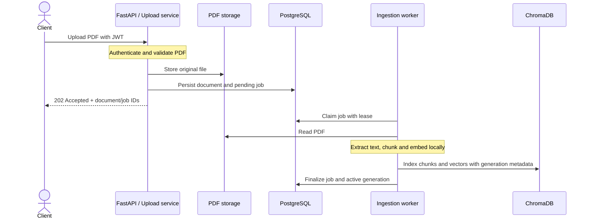
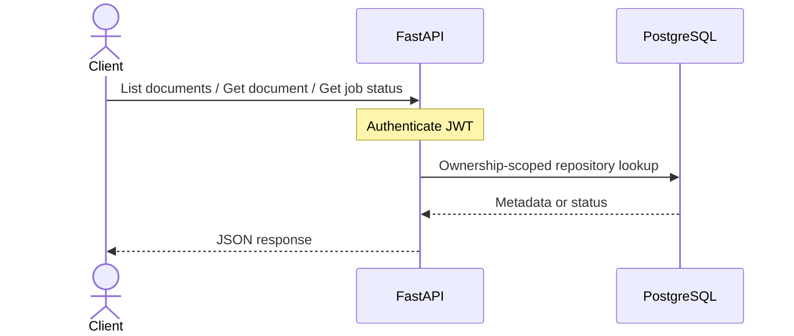
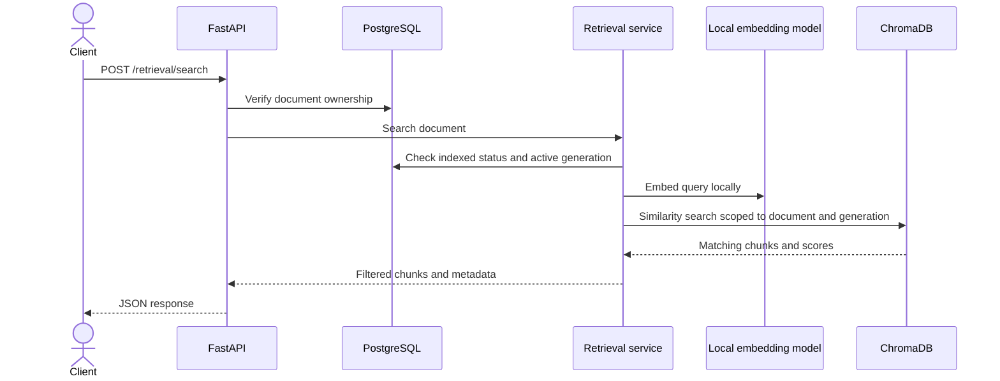
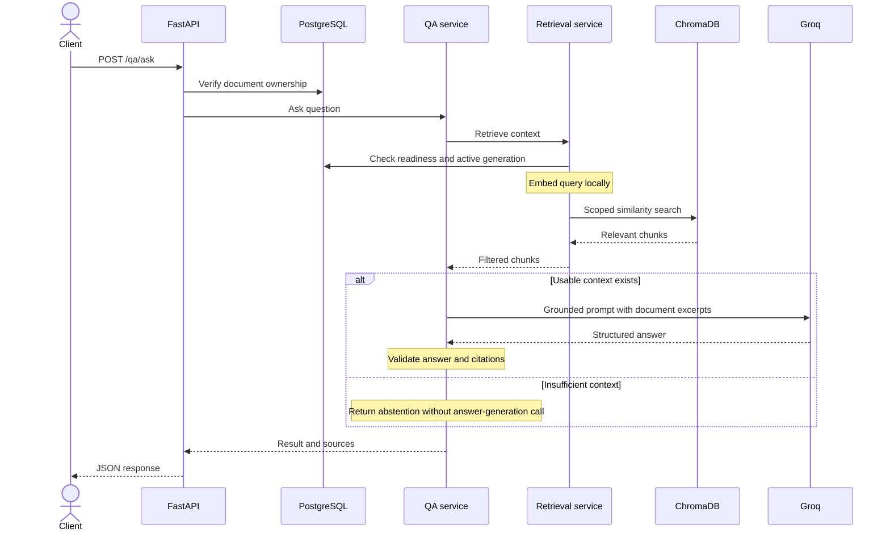
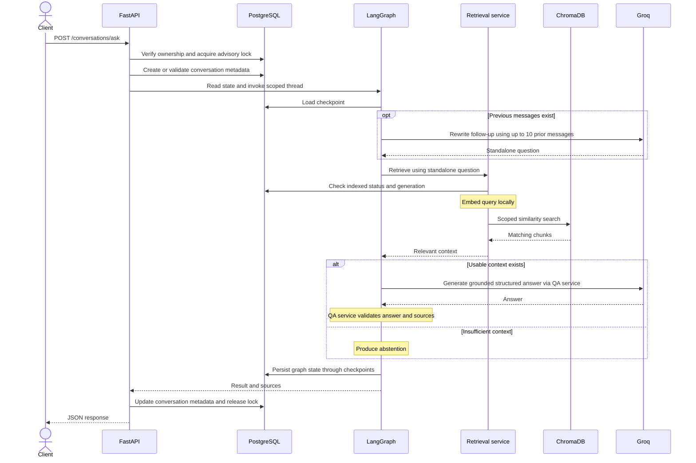

# Architecture and design decisions

RAGForge separates protected document management from retrieval and AI operations. Registration and login are public; protected routes authenticate the JWT and enforce resource ownership where applicable. PostgreSQL is the system of record, ChromaDB is the vector index, and the independent worker handles ingestion. These are separate workflows, not a single pipeline.

## 1. Document upload and asynchronous indexing

The worker polls independently of the HTTP request. Leases and bounded retries support recovery. Generation-aware retrieval avoids incomplete indexing generations; this is not an exactly-once guarantee. No generative LLM is needed for ingestion.

## 2. Document metadata and job status

No vector search or LLM is needed. Document viewing here means metadata, not downloading the original PDF.

## 3. Semantic search

The configured top-k and minimum relevance score constrain retrieval. No generative LLM is called.

## 4. Stateless question answering

Retrieval precedes generation. This endpoint does not persist conversational history.

## 5. Conversational RAG

Checkpoint writes can occur throughout graph execution; the diagram summarizes persistence. The first question bypasses rewriting. Follow-ups may call Groq before retrieval, then again for answer generation if context exists. Conversation list and history requests read PostgreSQL without running retrieval or generation.

## 6. Storage responsibilities

| Component | Responsibility |
|---|---|
| PostgreSQL | Users, document metadata, ingestion jobs, conversation metadata and LangGraph checkpoints |
| ChromaDB | Indexed text chunks, embeddings, document/generation identifiers and page/chunk metadata |
| Local PDF storage | Original PDFs shared between API and worker |
| Local embedding model | Document and query vectors; model cache on shared volume |
| Groq | Follow-up rewriting and grounded answer generation; not the application database |

## Trade-offs

| Decision | Benefit | Cost / limitation |
|---|---|---|
| PostgreSQL-backed queue | Fewer infrastructure dependencies | Polling and lease management |
| Separate worker | Slow PDF processing outside request lifecycle | Additional process and shared storage |
| Local embeddings | No external embedding API needed | CPU/RAM and model download |
| Separate vector database | Dedicated semantic retrieval | Additional service and consistency concerns |
| PostgreSQL checkpoints | Conversation history survives API restarts | Database lifecycle and concurrency management |
| Service/repository boundaries | Testable business logic and persistence separation | More modules than a simple script |
| Docker Compose | Reproducible local multi-service environment | Not high availability or managed orchestration |

The current trust boundary is individual user ownership, not organization-level tenancy. External Groq requests contain relevant document excerpts; optional tracing/evaluation can transmit additional data. Public deployment requires further operational and security controls.
